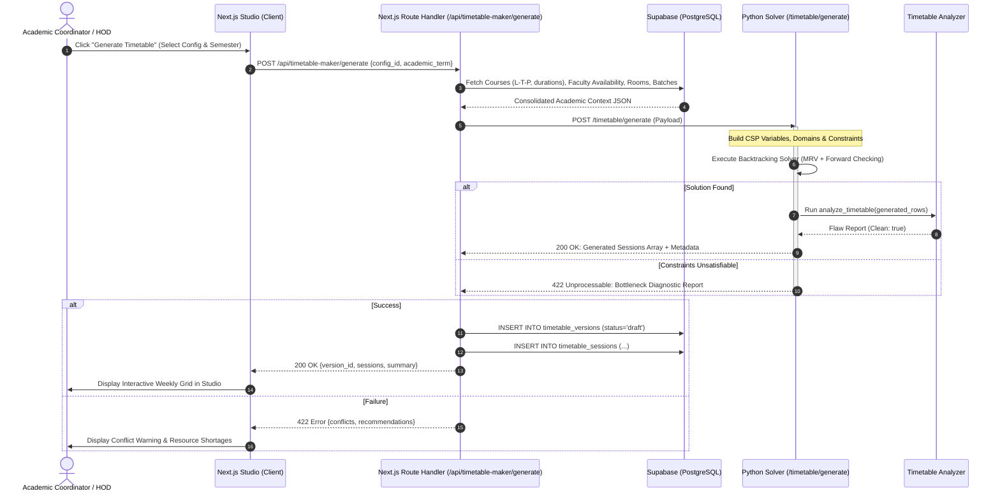
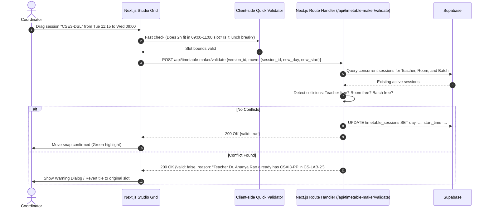
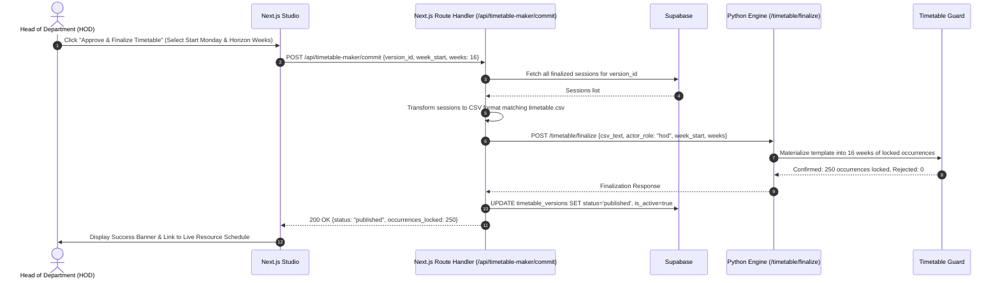
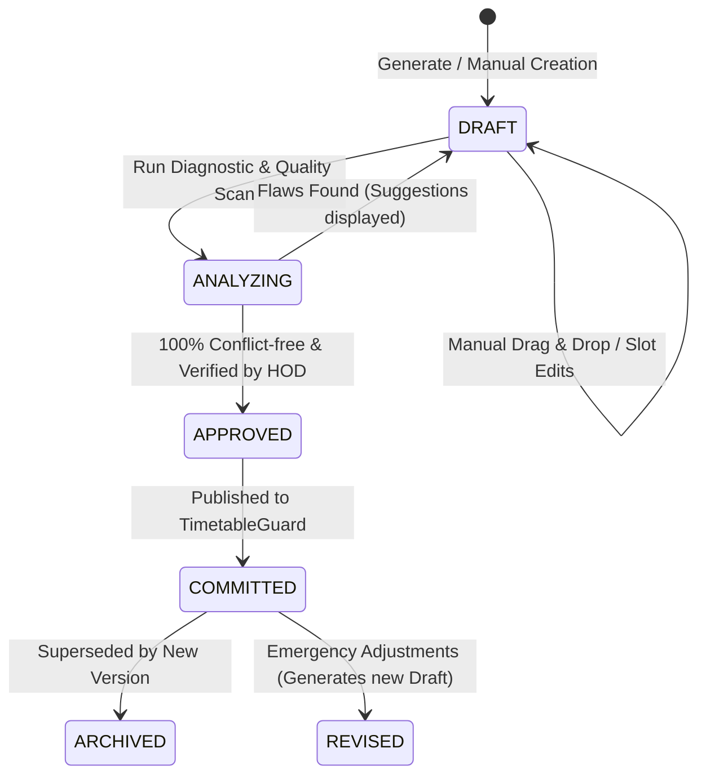

# Timetable Maker — System Architecture & Technical Design

## 1. High-Level Architectural Context

The Timetable Maker module integrates seamlessly into the existing **Smart Campus Resource Optimizer** hybrid architecture:
1. **Frontend & Application Gateway**: Next.js 15 (App Router, React 19, TypeScript).
2. **Scheduling & Optimization Microservice**: Python 3.11+ FastAPI service hosting the constraint solving engine, interval trees, and fairness algorithms.
3. **Persistent Database Layer**: **Supabase (PostgreSQL 15+)** providing relational persistence for academic catalogs, configurations, teacher availability, and timetable versions.
4. **Existing Guard & Allocation Engine**: `TimetableGuard`, `ConflictDetector`, and `BatchAlgorithmEngine` running in Python.

### Architectural Diagram
```
 ┌──────────────────────────────── Next.js 15 Web Application (App Router) ──────────────────────────────┐
 │                                                                                                        │
 │  app/                                                                                                  │
 │  ├── timetable/maker/                      <-- NEW: Timetable Maker Studio                             │
 │  │   ├── page.tsx                          Studio Dashboard (Grid, View Selector, Controls)           │
 │  │   ├── courses/page.tsx                  Course Catalog & L-T-P Editor                               │
 │  │   ├── teachers/page.tsx                 Teacher Profiles & Availability Grid                        │
 │  │   ├── rooms/page.tsx                    Room Types, Capacities & Facilities                         │
 │  │   ├── batches/page.tsx                  Batches & Lab Sub-group Manager                             │
 │  │   └── config/page.tsx                   Operational Hours, Periods & Break Settings                 │
 │  │                                                                                                     │
 │  ├── api/timetable-maker/                  <-- NEW: Web Gateway Route Handlers                         │
 │  │   ├── generate/route.ts                 POST: Dispatches generation job to Python microservice      │
 │  │   ├── validate/route.ts                 POST: Validates manual drag-and-drop moves                  │
 │  │   ├── commit/route.ts                   POST: Converts version to CSV & calls /timetable/finalize  │
 │  │   └── export/route.ts                   GET: Generates CSV, JSON, or PDF                            │
 │  │                                                                                                     │
 │  └── components/timetable-maker/           <-- NEW: Interactive React 19 Client Components             │
 │      ├── TimetableGrid.tsx                 Weekly Canvas (by Section, Faculty, Room)                   │
 │      ├── DraggableSession.tsx              HTML5 / Pointer Drag & Drop Tile                            │
 │      ├── ConflictBadge.tsx                 Real-time Hard/Soft Conflict Indicators                     │
 │      ├── LTPConfigModal.tsx                Course L-T-P and Duration Form                              │
 │      └── AvailabilityMatrix.tsx            Clickable 2D Grid for Teacher & Room Availability           │
 └──────────────────────┬─────────────────────────────────────────────────┬───────────────────────────────┘
                        │ Supabase JS Client (PostgREST / Auth)            │ HTTP / JSON
                        ▼                                                 ▼
 ┌──────────────────────────────────────┐     ┌───────────────────────────────────────────────────────────┐
 │       Supabase (PostgreSQL 15+)      │     │      Python 3.11+ FastAPI Microservice (api/main.py)      │
 │                                      │     │                                                           │
 │  • courses                           │     │  • src/algorithm_engine/timetable_generator.py (NEW)      │
 │  • teachers                          │     │    CSP / Backtracking Solver with MRV & Forward Checking  │
 │  • teacher_availability             │     │  • src/algorithm_engine/timetable_analyzer.py (REUSED)   │
 │  • rooms                             │     │    6-Category Flaw Detector (Faculty/Room/Section clash)  │
 │  • batches / student_groups          │     │  • src/algorithm_engine/timetable_guard.py (REUSED)      │
 │  • timetable_configs                 │     │    Materialization into 16-week horizon locks             │
 │  • timetable_versions                │     │  • src/algorithm_engine/engine.py & batch_engine.py       │
 │  • timetable_sessions                │     │    Underlying Priority-Aging Allocation Engine            │
 │  • audit_log (mirrored/extended)     │     │  • SQLite: audit_log.db (preserved for engine events)     │
 └──────────────────────────────────────┘     └───────────────────────────────────────────────────────────┘
```

---

## 2. Division of Responsibilities

### 2.1 Next.js 15 Application Layer
- **Interactive UI**: Fast, responsive client-side rendering with optimistic UI updates. Drag-and-drop feedback, cell highlighting, and view toggling.
- **Client-Side Quick Validation**: Immediate boundary checks (e.g., cannot drop a 2-hour lab in a 1-hour slot before lunch) using shared TypeScript helpers.
- **Data Access & Auth Gateway**: Directly interacts with Supabase using the `@supabase/ssr` / `@supabase/supabase-js` client for CRUD operations on Courses, Faculty, Rooms, and Batches, protected by PostgreSQL Row-Level Security (RLS).
- **Orchestration**: Serves as the bridge between Supabase and the Python Solver, submitting generation payloads and saving resolved sessions.

### 2.2 Python Algorithm Microservice Layer
- **Heavy Computational Logic**: Executes the combinatorial CSP / Backtracking search. Python is chosen because the existing core engine is Python-based, allowing native reuse of interval trees, resource models, and conflict analyzers.
- **Existing Timetable Integration**:
  - `timetable_analyzer.py` is invoked to verify that candidate timetables have zero structural flaws.
  - `timetable_guard.py` is invoked when the timetable is committed to lock out ad hoc bookings.

### 2.3 Supabase (PostgreSQL) Layer
- **System of Record**: Stores all academic catalog entities, user accounts, preferences, availability, configuration templates, and historic timetable revisions.
- **Referential Integrity**: Foreign keys guarantee that deleting a room or course is either blocked or handled safely with cascading rules.
- **Auditability & Versioning**: Complete history of generated drafts, human overrides, and publish dates.

---

## 3. Detailed Data Flow Pipelines

### 3.1 Automated Timetable Generation Flow


### 3.2 Manual Edit & Conflict Verification Flow


### 3.3 Publication & Guard Finalization Flow


---

## 4. Timetable Lifecycle State Machine

A timetable version progresses through distinct formal lifecycle stages:


1. **`draft`**: The schedule is being assembled or generated. Modifications can be freely made. It does not affect live campus room availability.
2. **`analyzed`**: The schedule has undergone automated analysis via `timetable_analyzer.py`. Reports hard conflicts, capacity issues, travel transitions, and load balance.
3. **`approved`**: The HOD has signed off on the academic distribution.
4. **`committed` / `published`**: The timetable has been pushed to `TimetableGuard`. All sessions are materialized across the semester horizon, locking classrooms and labs against ad hoc booking contention.
5. **`archived`**: Historical record preserved for auditing.

---

## 5. Security, Roles and RBAC

The Timetable Maker enforces strict Role-Based Access Control (RBAC):

| Role | Catalog CRUD (Courses, Rooms, Batches) | Configure Rules & Breaks | Generate Timetable | Edit Draft (Drag & Drop) | Approve & Publish | View Only |
|---|:---:|:---:|:---:|:---:|:---:|:---:|
| **HOD / Dean** | Full | Full | Full | Full | **Yes (Exclusive)** | Yes |
| **Timetable Admin** | Full | Full | Full | Full | No (Needs HOD Approval) | Yes |
| **Faculty Member** | Read-Only | Read-Only | No | No | No | Assigned Classes |
| **Student** | Read-Only | No | No | No | No | Batch Schedule |

### Authentication & Token Flow
- Requests will authenticate via Supabase Auth (JWT tokens).
- Route Handlers in Next.js verify the token using Supabase server client and inject the authenticated user identity and role into requests made to the Python microservice (`ENGINE_API_SECRET` header protects server-to-server traffic).
