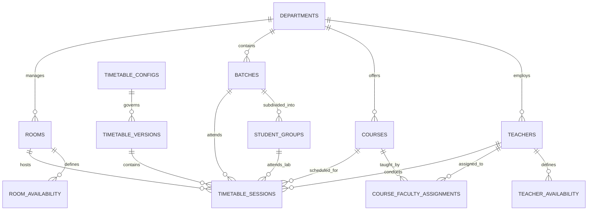

# Timetable Maker — Database Design & Schema Specification

## 1. Existing Database Audit & Rationale for Supabase

### 1.1 Existing State Verification
An inspection of the existing codebase confirms:
- **SQLite Audit Log**: The only persistent store currently in the repository is `audit_log.db` (`src/algorithm_engine/audit_log.py`), which stores an append-only log of ad hoc booking transactions (`id`, `ts`, `event_type`, `request_id`, `resource_id`, `user_id`, `details`).
- **No Domain Relational DB**: Courses, faculty, sections, and rooms are currently imported either via CSV files into in-memory dictionaries in the Python engine (`api/main.py`, `_dataset_meta`) or passed as transient request payloads.
- **Limitation**: Server restarts wipe all registered rooms, pending queues, and timetable states (except the SQLite audit trail).

### 1.2 Target Database: Supabase (PostgreSQL 15+)
In accordance with system requirements, **Supabase with PostgreSQL** is selected as the primary relational database. This provides:
- ACID compliance and relational integrity with primary keys, foreign keys, and unique constraints.
- Native JSONB support for flexible preference rules.
- High-performance indexing (B-Tree, GIST for temporal non-overlapping ranges).
- Built-in Row Level Security (RLS) and OAuth/JWT authentication.
- Realtime subscriptions for collaborative scheduling updates.

---

## 2. Entity-Relationship (ER) Diagram



---

## 3. Detailed Relational Schema (PostgreSQL DDL)

### 3.1 Academic Core & Infrastructure

```sql
-- Enable necessary extensions
CREATE EXTENSION IF NOT EXISTS "uuid-ossp";
CREATE EXTENSION IF NOT EXISTS "btree_gist";

-- ============================================================================
-- 1. DEPARTMENTS
-- ============================================================================
CREATE TABLE departments (
    id UUID PRIMARY KEY DEFAULT uuid_generate_v4(),
    code VARCHAR(20) NOT NULL UNIQUE,          -- e.g. 'CSE', 'ECE', 'ROB'
    name VARCHAR(100) NOT NULL,                 -- e.g. 'Computer Science & Engineering'
    hod_id UUID,                                -- Reference to teachers table (set after teacher creation)
    created_at TIMESTAMPTZ DEFAULT NOW(),
    updated_at TIMESTAMPTZ DEFAULT NOW()
);

-- ============================================================================
-- 2. TEACHERS (FACULTY)
-- ============================================================================
CREATE TABLE teachers (
    id UUID PRIMARY KEY DEFAULT uuid_generate_v4(),
    faculty_id VARCHAR(50) NOT NULL UNIQUE,     -- e.g. 'F001'
    user_id UUID REFERENCES auth.users(id),     -- Linked Supabase auth user
    department_id UUID NOT NULL REFERENCES departments(id) ON DELETE CASCADE,
    name VARCHAR(100) NOT NULL,                 -- e.g. 'Dr. Ananya Rao'
    email VARCHAR(150) UNIQUE,
    designation VARCHAR(50) DEFAULT 'Assistant Professor',
    max_weekly_hours NUMERIC(4,1) DEFAULT 20.0,
    max_daily_hours NUMERIC(3,1) DEFAULT 4.0,
    is_active BOOLEAN DEFAULT TRUE,
    created_at TIMESTAMPTZ DEFAULT NOW(),
    updated_at TIMESTAMPTZ DEFAULT NOW()
);

-- Circular FK for department HOD
ALTER TABLE departments 
ADD CONSTRAINT fk_dept_hod FOREIGN KEY (hod_id) REFERENCES teachers(id) ON DELETE SET NULL;

-- ============================================================================
-- 3. TEACHER AVAILABILITY RESTRICTIONS
-- ============================================================================
CREATE TABLE teacher_availability (
    id UUID PRIMARY KEY DEFAULT uuid_generate_v4(),
    teacher_id UUID NOT NULL REFERENCES teachers(id) ON DELETE CASCADE,
    day_of_week VARCHAR(10) NOT NULL CHECK (day_of_week IN ('Mon', 'Tue', 'Wed', 'Thu', 'Fri', 'Sat')),
    start_time TIME NOT NULL,
    end_time TIME NOT NULL,
    availability_type VARCHAR(20) DEFAULT 'unavailable' CHECK (availability_type IN ('available', 'unavailable', 'preferred')),
    reason VARCHAR(255),
    CONSTRAINT chk_teacher_time_order CHECK (start_time < end_time)
);

-- ============================================================================
-- 4. ROOMS & LABORATORIES
-- ============================================================================
CREATE TABLE rooms (
    id UUID PRIMARY KEY DEFAULT uuid_generate_v4(),
    room_id VARCHAR(50) NOT NULL UNIQUE,        -- e.g. 'CS-LAB-1', 'CS-CLASSROOM-101'
    name VARCHAR(100) NOT NULL,
    building VARCHAR(100) NOT NULL,             -- e.g. 'Block-A (CSE)'
    floor INT DEFAULT 1,
    room_type VARCHAR(50) NOT NULL CHECK (
        room_type IN ('classroom', 'lab', 'seminar_hall', 'workshop', 'auditorium', 'equipment_pool')
    ),
    lab_specialization VARCHAR(100),            -- e.g. 'AI/ML GPU', 'Electronics', 'DSA'
    capacity INT NOT NULL CHECK (capacity > 0),
    exclusive_use BOOLEAN DEFAULT TRUE,
    department_id UUID REFERENCES departments(id) ON DELETE SET NULL,
    is_active BOOLEAN DEFAULT TRUE,
    created_at TIMESTAMPTZ DEFAULT NOW()
);

-- ============================================================================
-- 5. ROOM AVAILABILITY RESTRICTIONS
-- ============================================================================
CREATE TABLE room_availability (
    id UUID PRIMARY KEY DEFAULT uuid_generate_v4(),
    room_id UUID NOT NULL REFERENCES rooms(id) ON DELETE CASCADE,
    day_of_week VARCHAR(10) NOT NULL CHECK (day_of_week IN ('Mon', 'Tue', 'Wed', 'Thu', 'Fri', 'Sat')),
    start_time TIME NOT NULL,
    end_time TIME NOT NULL,
    is_available BOOLEAN DEFAULT FALSE,         -- False indicates maintenance/reserved block
    reason VARCHAR(255) DEFAULT 'Maintenance / Department Reserved',
    CONSTRAINT chk_room_time_order CHECK (start_time < end_time)
);
```

### 3.2 Academic Curriculum & Batches

```sql
-- ============================================================================
-- 6. COURSES (With L-T-P & Configurable Session Durations)
-- ============================================================================
CREATE TABLE courses (
    id UUID PRIMARY KEY DEFAULT uuid_generate_v4(),
    course_code VARCHAR(50) NOT NULL UNIQUE,    -- e.g. 'CSAI5-DL'
    course_name VARCHAR(150) NOT NULL,          -- e.g. 'Deep Learning Fundamentals'
    department_id UUID NOT NULL REFERENCES departments(id) ON DELETE CASCADE,
    semester INT NOT NULL CHECK (semester BETWEEN 1 AND 8),
    academic_year VARCHAR(20) NOT NULL,         -- e.g. '2026-2027'
    credits NUMERIC(3,1) NOT NULL DEFAULT 4.0,  -- Academic Credits (distinct from hours)
    
    -- L-T-P Session Counts (Weekly requirements)
    lecture_count INT NOT NULL DEFAULT 3,       -- L: Number of Theory sessions/week
    tutorial_count INT NOT NULL DEFAULT 0,      -- T: Number of Tutorial sessions/week
    practical_count INT NOT NULL DEFAULT 0,     -- P: Number of Practical sessions/week
    
    -- Configurable Durations in Hours per individual session
    lecture_duration NUMERIC(3,2) NOT NULL DEFAULT 1.00,   -- Theory session duration (e.g. 1.0h)
    tutorial_duration NUMERIC(3,2) NOT NULL DEFAULT 1.00,  -- Tutorial session duration (e.g. 1.0h)
    practical_duration NUMERIC(3,2) NOT NULL DEFAULT 2.00, -- Practical lab session duration (e.g. 2.0h or 3.0h)
    
    -- Calculated Contact Hours Generated Column
    total_weekly_hours NUMERIC(4,2) GENERATED ALWAYS AS (
        (lecture_count * lecture_duration) + 
        (tutorial_count * tutorial_duration) + 
        (practical_count * practical_duration)
    ) STORED,

    required_room_type VARCHAR(50) DEFAULT 'classroom',
    required_lab_specialization VARCHAR(100),
    created_at TIMESTAMPTZ DEFAULT NOW(),
    updated_at TIMESTAMPTZ DEFAULT NOW()
);

-- ============================================================================
-- 7. BATCHES & SECTIONS
-- ============================================================================
CREATE TABLE batches (
    id UUID PRIMARY KEY DEFAULT uuid_generate_v4(),
    section_id VARCHAR(50) NOT NULL UNIQUE,     -- e.g. 'CSE-3-A'
    department_id UUID NOT NULL REFERENCES departments(id) ON DELETE CASCADE,
    semester INT NOT NULL,
    section_name VARCHAR(10) NOT NULL,          -- e.g. 'A'
    strength INT NOT NULL CHECK (strength > 0), -- e.g. 65 students
    academic_year VARCHAR(20) NOT NULL,
    created_at TIMESTAMPTZ DEFAULT NOW()
);

-- ============================================================================
-- 8. STUDENT GROUPS (For Lab Splitting)
-- ============================================================================
CREATE TABLE student_groups (
    id UUID PRIMARY KEY DEFAULT uuid_generate_v4(),
    batch_id UUID NOT NULL REFERENCES batches(id) ON DELETE CASCADE,
    group_name VARCHAR(20) NOT NULL,            -- e.g. 'Batch A1', 'Batch A2'
    strength INT NOT NULL CHECK (strength > 0), -- e.g. 33 students
    CONSTRAINT unq_batch_group UNIQUE (batch_id, group_name)
);

-- ============================================================================
-- 9. COURSE-FACULTY-BATCH ASSIGNMENTS
-- ============================================================================
CREATE TABLE course_assignments (
    id UUID PRIMARY KEY DEFAULT uuid_generate_v4(),
    course_id UUID NOT NULL REFERENCES courses(id) ON DELETE CASCADE,
    teacher_id UUID NOT NULL REFERENCES teachers(id) ON DELETE CASCADE,
    batch_id UUID NOT NULL REFERENCES batches(id) ON DELETE CASCADE,
    group_id UUID REFERENCES student_groups(id) ON DELETE SET NULL, -- NULL = entire batch
    role_type VARCHAR(20) DEFAULT 'primary' CHECK (role_type IN ('primary', 'assistant', 'lab_tutor')),
    CONSTRAINT unq_assignment UNIQUE (course_id, teacher_id, batch_id, group_id)
);
```

### 3.3 Timetable Configuration, Versioning & Sessions

```sql
-- ============================================================================
-- 10. TIMETABLE CONFIGURATION TEMPLATES
-- ============================================================================
CREATE TABLE timetable_configs (
    id UUID PRIMARY KEY DEFAULT uuid_generate_v4(),
    name VARCHAR(100) NOT NULL,                 -- e.g. 'Odd Semester 2026 Regular'
    department_id UUID REFERENCES departments(id) ON DELETE CASCADE,
    working_days JSONB NOT NULL DEFAULT '["Mon", "Tue", "Wed", "Thu", "Fri"]'::jsonb,
    day_start_time TIME NOT NULL DEFAULT '08:00:00',
    day_end_time TIME NOT NULL DEFAULT '17:00:00',
    period_duration_minutes INT NOT NULL DEFAULT 60,
    break_slots JSONB NOT NULL DEFAULT '[
        {"name": "Short Break", "start": "11:00:00", "end": "11:15:00"},
        {"name": "Lunch Break", "start": "13:15:00", "end": "14:00:00"}
    ]'::jsonb,
    max_faculty_daily_hours INT DEFAULT 4,
    created_at TIMESTAMPTZ DEFAULT NOW()
);

-- ============================================================================
-- 11. TIMETABLE VERSIONS
-- ============================================================================
CREATE TABLE timetable_versions (
    id UUID PRIMARY KEY DEFAULT uuid_generate_v4(),
    config_id UUID NOT NULL REFERENCES timetable_configs(id),
    department_id UUID NOT NULL REFERENCES departments(id),
    academic_year VARCHAR(20) NOT NULL,
    semester_type VARCHAR(10) NOT NULL CHECK (semester_type IN ('odd', 'even', 'summer')),
    version_number INT NOT NULL DEFAULT 1,
    name VARCHAR(100) NOT NULL,                 -- e.g. 'Draft v1 (CSP Solved)'
    status VARCHAR(20) NOT NULL DEFAULT 'draft' CHECK (
        status IN ('draft', 'analyzed', 'approved', 'published', 'archived')
    ),
    is_active BOOLEAN DEFAULT FALSE,            -- Only 1 published version active per semester/dept
    solver_metadata JSONB,                      -- Solved time, iterations, soft score, heuristics used
    created_by UUID REFERENCES auth.users(id),
    created_at TIMESTAMPTZ DEFAULT NOW(),
    updated_at TIMESTAMPTZ DEFAULT NOW()
);

-- ============================================================================
-- 12. TIMETABLE SESSIONS (The Individual Scheduled Slots)
-- ============================================================================
CREATE TABLE timetable_sessions (
    id UUID PRIMARY KEY DEFAULT uuid_generate_v4(),
    version_id UUID NOT NULL REFERENCES timetable_versions(id) ON DELETE CASCADE,
    course_id UUID NOT NULL REFERENCES courses(id) ON DELETE RESTRICT,
    teacher_id UUID NOT NULL REFERENCES teachers(id) ON DELETE RESTRICT,
    room_id UUID NOT NULL REFERENCES rooms(id) ON DELETE RESTRICT,
    batch_id UUID NOT NULL REFERENCES batches(id) ON DELETE RESTRICT,
    group_id UUID REFERENCES student_groups(id) ON DELETE SET NULL, -- NULL if whole batch
    
    session_type VARCHAR(20) NOT NULL CHECK (session_type IN ('theory', 'tutorial', 'lab')),
    day_of_week VARCHAR(10) NOT NULL CHECK (day_of_week IN ('Mon', 'Tue', 'Wed', 'Thu', 'Fri', 'Sat')),
    start_time TIME NOT NULL,
    end_time TIME NOT NULL,
    duration_hours NUMERIC(3,2) NOT NULL,
    
    is_locked BOOLEAN DEFAULT FALSE,            -- If TRUE, regeneration preserves this slot
    created_at TIMESTAMPTZ DEFAULT NOW(),
    
    CONSTRAINT chk_session_times CHECK (start_time < end_time)
);

-- Indexes for lightning-fast queries and collision detection
CREATE INDEX idx_sessions_version ON timetable_sessions(version_id);
CREATE INDEX idx_sessions_batch ON timetable_sessions(batch_id, day_of_week, start_time);
CREATE INDEX idx_sessions_teacher ON timetable_sessions(teacher_id, day_of_week, start_time);
CREATE INDEX idx_sessions_room ON timetable_sessions(room_id, day_of_week, start_time);
```

---

## 4. Row Level Security (RLS) & Access Control

```sql
-- Enable RLS on core timetable tables
ALTER TABLE timetable_configs ENABLE ROW LEVEL SECURITY;
ALTER TABLE timetable_versions ENABLE ROW LEVEL SECURITY;
ALTER TABLE timetable_sessions ENABLE ROW LEVEL SECURITY;

-- 1. Everyone can read published timetable sessions
CREATE POLICY "Public read published timetables"
ON timetable_sessions FOR SELECT
USING (
    EXISTS (
        SELECT 1 FROM timetable_versions v 
        WHERE v.id = timetable_sessions.version_id 
        AND v.status = 'published'
    )
);

-- 2. HOD and Timetable Admin have full CRUD on their department's sessions
CREATE POLICY "Department admin manage sessions"
ON timetable_sessions FOR ALL
TO authenticated
USING (
    EXISTS (
        SELECT 1 FROM timetable_versions v
        JOIN departments d ON d.id = v.department_id
        WHERE v.id = timetable_sessions.version_id
        AND (auth.jwt() ->> 'role' IN ('hod', 'admin'))
    )
);
```
