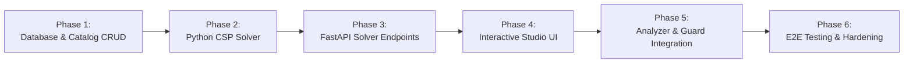

# Timetable Maker — Implementation Roadmap & Execution Plan

## 1. Phased Implementation Overview

The implementation is structured into **6 sequential, dependency-governed phases**. Each phase produces a testable milestone, ensuring zero regressions to the existing Smart Campus Resource Optimizer.

---

## 2. Phase Breakdown & File Mapping

### Phase 1: Database Setup & Academic Catalog CRUD (Next.js & Supabase)
**Goal:** Establish persistent PostgreSQL database schemas and administrative screens to manage courses, L-T-P parameters, teacher availability, rooms, and batches.

- **New Files to Create:**
  - `supabase/migrations/20261030_timetable_init.sql`: DDL for all 12 tables, indexes, constraints, and RLS policies.
  - `lib/supabase.ts`: Supabase client and server-side connection helpers.
  - `lib/types/timetable.ts`: TypeScript interfaces for Course, Teacher, Room, Batch, Config, and Session.
  - `app/timetable/maker/layout.tsx`: Sub-navigation bar for Timetable Maker.
  - `app/timetable/maker/courses/page.tsx`: Course catalog CRUD with L-T-P spinners and duration inputs.
  - `app/timetable/maker/teachers/page.tsx`: Faculty directory with clickable availability matrix.
  - `app/timetable/maker/rooms/page.tsx`: Room and laboratory inventory with types and equipment tags.
  - `app/timetable/maker/batches/page.tsx`: Batch and student group manager.
  - `app/timetable/maker/config/page.tsx`: Operational hours, period durations, and break windows.
- **Existing Files Modified:**
  - `components/Nav.tsx`: Add link to `Timetable Studio` under navigation items.
  - `package.json`: Add `@supabase/supabase-js` and `@supabase/ssr`.
- **Milestone 1:** Academic administrators can populate and edit courses (with L-T-P values and durations), faculty availability, rooms, and student sections directly in the UI.

---

### Phase 2: Python CSP Scheduling Engine (Core Solver)
**Goal:** Implement the deterministic Backtracking + MRV + Forward Checking CSP solver in Python.

- **New Files to Create:**
  - `src/algorithm_engine/timetable_solver/`: Dedicated package for timetable generation.
    - `__init__.py`: Solver exports.
    - `models.py`: Data classes (`SessionVariable`, `TimeSlot`, `SolverDomain`, `SolverProblem`).
    - `expander.py`: Expands courses with $(L, d_L, T, d_T, P, d_P)$ into discrete session variables.
    - `constraints.py`: Hard constraint validators (teacher, room, batch, capacity, lab continuity, breaks).
    - `heuristics.py`: MRV, Degree Heuristics, Least Constraining Value, and soft objective scoring.
    - `solver.py`: Core recursive backtracking search with forward checking.
    - `diagnostics.py`: Root-cause bottleneck analyzer for unschedulable states.
  - `tests/test_timetable_solver.py`: Pytest suite covering single-batch, multi-batch, lab splitting, and conflict detection.
- **Milestone 2:** Running `pytest tests/test_timetable_solver.py` passes 100% of synthetic academic test cases within 3 seconds.

---

### Phase 3: FastAPI Microservice Endpoints
**Goal:** Expose the CSP solver and quick-validation routines as REST endpoints in `api/main.py`.

- **Existing Files Modified:**
  - `api/main.py`:
    - Add `POST /timetable/generate`: Accepts JSON academic catalog + configuration, runs `solver.py`, returns solved sessions or 422 diagnostic report.
    - Add `POST /timetable/validate-move`: Accepts a candidate move and checks hard constraint violations against existing sessions.
- **New Files to Create:**
  - `app/api/timetable-maker/generate/route.ts`: Next.js Route Handler querying Supabase and proxying to `POST /timetable/generate`.
  - `app/api/timetable-maker/validate/route.ts`: Next.js Route Handler proxying to `POST /timetable/validate-move`.
- **Milestone 3:** The Next.js API layer can trigger automated timetable generation and validate individual slot placements over HTTP.

---

### Phase 4: Timetable Studio Frontend (Interactive Grid & Drag-and-Drop)
**Goal:** Build the visual calendar grid with filter views, drag-and-drop rescheduling, conflict alerts, and partial lock & regenerate.

- **New Files to Create:**
  - `app/timetable/maker/page.tsx`: Studio dashboard page.
  - `components/timetable-maker/TimetableGrid.tsx`: Weekly calendar grid (columns = Days, rows = Periods).
  - `components/timetable-maker/DraggableSession.tsx`: Interactive session block with course code, room, teacher, lock toggle.
  - `components/timetable-maker/UnscheduledPool.tsx`: Drawer of unplaced sessions available to drag onto the grid.
  - `components/timetable-maker/ConflictInspector.tsx`: Real-time diagnostic panel displaying soft/hard findings.
  - `components/timetable-maker/StudioToolbar.tsx`: Action bar with "Generate", "Lock & Re-Gen", "Analyze", "Publish", and Filter selectors (by Batch, Teacher, Room).
- **Existing Files Modified:**
  - `app/globals.css`: Add styles for timetable studio grid, drag-over highlights, and session tile states.
- **Milestone 4:** Users can generate a draft timetable, view it across batch/teacher/room perspectives, drag-and-drop classes with instant visual collision feedback, lock specific slots, and re-generate remaining periods.

---

### Phase 5: Pipeline Integration, Guard Finalization & Export
**Goal:** Connect the generated timetable directly to the existing `TimetableAnalyzer` and `TimetableGuard`, and provide CSV/PDF export.

- **New Files to Create:**
  - `app/api/timetable-maker/commit/route.ts`: Converts published timetable sessions into CSV format and submits to `POST /timetable/finalize`.
  - `app/api/timetable-maker/export/route.ts`: Outputs timetable in CSV (matching `timetable.csv`), JSON, or print-ready HTML/PDF.
  - `components/timetable-maker/ExportModal.tsx`: Export dialog for downloading schedules.
- **Existing Files Modified:**
  - `lib/engine.ts`: Add helper functions to query timetable maker endpoints.
  - `src/algorithm_engine/timetable_guard.py`: Ensure that finalized sessions generated from the Timetable Maker are fully locked against ad hoc bookings.
- **Milestone 5:** One-click finalization commits the generated timetable to the 16-week horizon in `TimetableGuard`, locking rooms against conflicting ad hoc bookings.

---

### Phase 6: End-to-End Verification, Performance Benchmarking & Hardening
**Goal:** Conduct exhaustive integration testing, stress testing with real department datasets (`data/tt_opt/`), and edge-case handling.

- **Verification Items:**
  - Execute full test suite: `npm run test`, `npm run typecheck`, and `pytest`.
  - Test benchmark with 10 sections and 60 courses: Verify solving time $\le 5$ seconds.
  - Test edge cases: Overbooked teachers, lab duration exceeding day limits, zero available rooms.
  - End-to-end user testing: Add course with L-T-P `3-1-2` $\to$ Generate $\to$ Move class $\to$ Lock $\to$ Regenerate $\to$ Publish $\to$ Verify ad hoc booking is blocked on locked slot.
- **Milestone 6:** Production-ready release ready for deployment and evaluation.

---

## 3. Risk Assessment & Mitigation

| Identified Risk | Severity | Likelihood | Mitigation Strategy |
|---|:---:|:---:|---|
| **Combinatorial Explosion (Solver Timeout)** | High | Medium | Implement MRV heuristic + fail-first ordering; prioritize multi-hour labs; cap search depth with a 15-second watchdog timer; return partial schedule with bottleneck explanation if timeout occurs. |
| **Lab Continuity Splitting across Lunch** | Medium | High | Hard constraint validator treats slots spanning lunch break or day end as illegal domains during variable expansion. |
| **Regression in Ad Hoc Scheduling** | High | Low | The existing Stage 1-4 allocation pipeline is completely isolated. The generator only produces `TimetableRow` structures fed into the existing `TimetableGuard.finalize()` method. |
| **Database Network Latency** | Low | Low | Cache active semester catalogs in Next.js Server Component memory during active studio editing sessions. |
