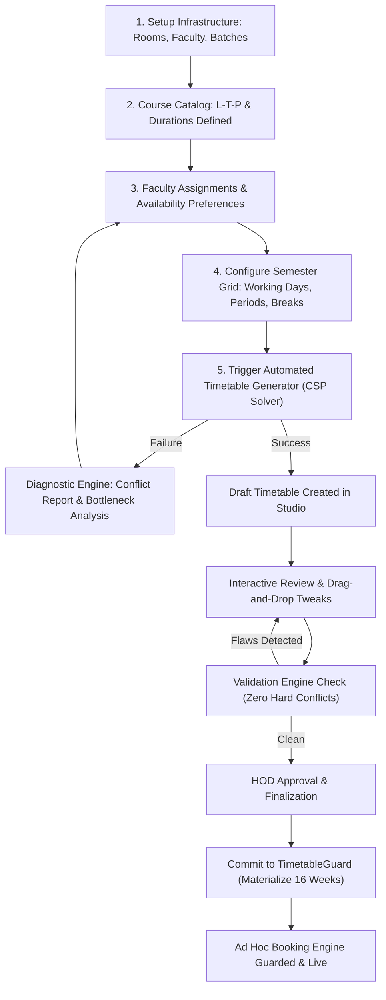

# Timetable Maker — Requirements & Specifications

## 1. Problem Statement & Motivation

In collegiate academic institutions, building a conflict-free weekly timetable is a high-dimensional combinatorial problem. Academic coordinators and Heads of Department (HODs) face multiple rigid physical and human constraints:
- Faculty must not have overlapping classes or back-to-back cross-campus runs without setup time.
- Batches of students cannot be scheduled for two concurrent subjects.
- Specific courses require specialized laboratory facilities (e.g., GPU labs, electronics benches) which have strictly limited capacity.
- Practicals and laboratory sessions need continuous multi-hour blocks (e.g., 2 or 3 consecutive hours) and cannot be interrupted by breaks or day boundaries.
- Academic regulations prescribe specific weekly contact requirements defined by **L-T-P** (Lecture-Tutorial-Practical) structures.

The current system allows analyzing and locking an uploaded CSV schedule, but lacks an automated generation engine and interactive editing studio. The goal of this module is to provide an end-to-end Timetable Maker that automates schedule generation, allows manual overrides with instant conflict verification, and seamlessly commits the final timetable to the Smart Campus Resource Optimizer.

---

## 2. L-T-P Understanding & Weekly Contact Hours

### 2.1 The L-T-P Convention
Academic courses specify credits and contact hours using the standard **L-T-P** notation:
- **L (Lecture):** Number of theory sessions per week.
  - Standard duration: **1 hour** (60 minutes) per session.
- **T (Tutorial):** Number of problem-solving/interactive sessions per week.
  - Duration: **Configurable per course** (default: 1 hour, or college-configured period).
- **P (Practical):** Number of hands-on laboratory sessions per week.
  - Duration: **Configurable per course/lab** (commonly 2.0 or 3.0 hours continuous block).

### 2.2 Mathematical Formulation of Weekly Contact Hours
Let a course $C$ have parameters:
- $L$: number of weekly theory sessions
- $d_L$: duration of each theory session in hours (default $= 1.0$)
- $T$: number of weekly tutorial sessions
- $d_T$: duration of each tutorial session in hours (e.g., $1.0$)
- $P$: number of weekly practical sessions
- $d_P$: duration of each practical session in hours (e.g., $2.0$ or $3.0$)

The **Total Weekly Teaching Hours** ($WTH_C$) required for course $C$ is computed as:
$$WTH_C = (L \times d_L) + (T \times d_T) + (P \times d_P)$$

### 2.3 Credits Disconnect
- **Credits ($Cr$)**: Academic weight representing student evaluation workload (e.g., 4 credits).
- **Rule**: Session duration and contact hours **must not** be inferred from credits. Credits are stored for accreditation, reporting, and student load tracking, while actual timetable scheduling operates exclusively on $(L, d_L, T, d_T, P, d_P)$.

### 2.4 Concrete Example
Course: `CSAI5-DL` (Deep Learning Fundamentals)
- L-T-P = `3-1-2`
- Theory Session Duration: $d_L = 1.0\text{ h}$
- Tutorial Session Duration: $d_T = 1.0\text{ h}$
- Practical Session Duration: $d_P = 2.0\text{ h}$
- Weekly Sessions:
  - 3 theory sessions of 1.0h = 3.0 hours
  - 1 tutorial session of 1.0h = 1.0 hour
  - 2 practical sessions of 2.0h = 4.0 hours
- Total Weekly Teaching Hours = $3.0 + 1.0 + 4.0 = \mathbf{8.0}\text{ hours/week}$.
- The scheduler must allocate exactly these 6 distinct sessions across the week without collision.

---

## 3. Functional Requirements Breakdown

### Module A: Course Management (FR-TT-01)
- **FR-TT-01.1**: Add, update, archive, and view courses.
- **FR-TT-01.2**: Store Course ID (`cid` / `course_code`), Course Name (`cname`), Department/Branch, Semester, Academic Year, and Credits.
- **FR-TT-01.3**: Store L-T-P integer components $(L, T, P)$.
- **FR-TT-01.4**: Configure custom session duration for Theory ($d_L$), Tutorial ($d_T$), and Practical ($d_P$).
- **FR-TT-01.5**: Assign eligible faculty members to courses (with primary and secondary instructors).
- **FR-TT-01.6**: Designate required room type per session component (e.g., Theory $\to$ `classroom`, Practical $\to$ `lab:ai_ml`, Tutorial $\to$ `classroom` or `seminar_hall`).

### Module B: Teacher / Faculty Management (FR-TT-02)
- **FR-TT-02.1**: Manage teacher profile: ID, Name, Department, Designation, Email, Max Weekly Workload (hours).
- **FR-TT-02.2**: Maintain Teacher Availability Matrix: specify unavailable days/periods or preferred time slots (e.g., no sessions on Wednesday afternoons, research day on Friday).
- **FR-TT-02.3**: Prevent teacher double-booking across different batches or rooms during generation and manual editing.
- **FR-TT-02.4**: Track workload allocation to prevent teacher fatigue (e.g., max 4 hours of lectures/day per teacher).

### Module C: Classroom & Laboratory Management (FR-TT-03)
- **FR-TT-03.1**: Manage physical resources: Room ID, Name, Building/Block, Floor, Seating Capacity, Exclusivity Flag (`exclusive_use`).
- **FR-TT-03.2**: Room Type Categorization: `classroom`, `computer_lab`, `hardware_lab`, `seminar_hall`, `workshop`, `auditorium`.
- **FR-TT-03.3**: Tag room capabilities/equipment (e.g., GPU cluster, projectors, microcontrollers).
- **FR-TT-03.4**: Ensure practical sessions are strictly allocated to rooms matching the required laboratory type and equipment.
- **FR-TT-03.5**: Maintain Room Availability & Maintenance windows (e.g., Lab unavailable Monday 08:00–10:00 for maintenance).

### Module D: Batch & Student Group Management (FR-TT-04)
- **FR-TT-04.1**: Define Student Batches/Sections: Branch, Semester, Section Name (e.g., `CSE-3-A`), Total Strength.
- **FR-TT-04.2**: Support Sub-Batches / Lab Groups: split a section into smaller practical groups (e.g., Section A into `Batch A1` and `Batch A2`, 30 students each) when laboratory capacity is lower than total section strength.
- **FR-TT-04.3**: Allow parallel lab scheduling: Batch A1 in Lab 1 while Batch A2 is in Lab 2, or Batch A1 in Lab while Batch A2 is in Tutorial.
- **FR-TT-04.4**: Enforce that a student section cannot have conflicting theory sessions.

### Module E: Timetable Configuration & Institutional Constraints (FR-TT-05)
- **FR-TT-05.1**: Working Days: Configurable 5-day (Mon–Fri) or 6-day (Mon–Sat) schedule.
- **FR-TT-05.2**: Campus Operational Hours: Start time (e.g., 08:00) and End time (e.g., 17:00).
- **FR-TT-05.3**: Period Grid Definition: Discretize working hours into standard slots (e.g., 1-hour periods: P1 08:00–09:00, P2 09:00–10:00, etc.).
- **FR-TT-05.4**: Break & Lunch Windows: Fixed non-instructional slots (e.g., Short Break 11:00–11:15, Lunch Break 13:00–14:00) where no sessions may be scheduled.
- **FR-TT-05.5**: Consecutive Slot Rules: Multi-hour sessions (such as 2-hour or 3-hour labs) must occupy consecutive periods and must not cross lunch break or day end boundaries.

### Module F: Timetable Generation Engine (FR-TT-06)
- **FR-TT-06.1**: Automated Generation using Constraint Satisfaction Problem (CSP) / Backtracking with MRV heuristics and forward checking.
- **FR-TT-06.2**: Hard Constraint Satisfaction:
  1. Teacher conflict-free: No teacher scheduled in $>1$ room at the same time.
  2. Room conflict-free: No room assigned to $>1$ session at the same time (unless non-exclusive and within capacity).
  3. Batch conflict-free: No student batch/section scheduled for $>1$ session simultaneously.
  4. Capacity compliance: Assigned room capacity $\ge$ student group headcount.
  5. Room type match: Theory in classrooms; Labs in corresponding laboratory types.
  6. Block continuity: Multi-hour sessions must be contiguous.
- **FR-TT-06.3**: Soft Constraint Optimization:
  1. Balanced distribution: Distribute sessions evenly across days (avoid clustering 4 hours on Monday and 0 on Thursday).
  2. Idle gap minimization: Minimize empty periods between classes for student batches and faculty.
  3. Theory timing: Preference for core lectures in morning hours (09:00–12:00) and lab sessions in afternoon blocks.
- **FR-TT-06.4**: Unschedulability Explanation: If no feasible timetable exists, identify the precise bottleneck (e.g., "Teacher F002 exceeds weekly availability by 4 hours", or "Lab CS-LAB-1 has 42 hours of demand but only 35 operating hours").

### Module G: Timetable Studio & Management (FR-TT-07)
- **FR-TT-07.1**: Multi-Perspective Grid View:
  - **Batch/Section View**: View weekly grid for a specific section (e.g., CSE-3-A).
  - **Faculty View**: View weekly grid for an individual instructor.
  - **Room View**: View weekly grid for a specific classroom or lab.
- **FR-TT-07.2**: Interactive Drag-and-Drop: Drag a session card to a new slot with real-time collision detection before drop.
- **FR-TT-07.3**: Manual Cell Editor: Click any cell to add, replace, or remove a session.
- **FR-TT-07.4**: Selective Locking: Lock specific confirmed slots (e.g., university common exams or visiting professor slots) and regenerate the remaining unscheduled sessions without losing locked positions.
- **FR-TT-07.5**: Timetable Versioning: Save drafts, maintain history of changes, compare versions side-by-side.
- **FR-TT-07.6**: Direct Commit / Finalization: One-click export into the existing `TimetableGuard` (`POST /timetable/finalize`), seamlessly materializing the schedule into the resource optimizer.
- **FR-TT-07.7**: Export Options: Export to CSV (matching `timetable.csv` schema), JSON, and formatted printable PDF / Excel.

---

## 4. User Roles and Workflows

### 4.1 Personas
1. **Academic Dean / HOD (Head of Department)**: Master authority. Defines timetable configuration, runs auto-generation, approves overrides, and finalizes the official schedule.
2. **Timetable Coordinator / Admin**: Inputs courses, faculty assignments, rooms, and constraints; iterates on drafts; resolves generation flaws.
3. **Faculty Member**: Views assigned teaching schedule; submits slot preferences and leave/unavailability requests.
4. **Student**: Views class timetable by branch, semester, and section; checks room locations.

### 4.2 End-to-End Workflow Diagram

---

## 5. Non-Functional Requirements (NFRs)

| NFR ID | Attribute | Specification |
|---|---|---|
| **NFR-TT-01** | **Solver Performance** | Full timetable generation for a department of 10 sections, 40 courses, and 30 faculty must solve in $\le 5$ seconds. Large multi-department setups ($\le 50$ sections) must complete in $\le 30$ seconds. |
| **NFR-TT-02** | **Deterministic Output** | Given the same inputs and seed, the scheduler must generate reproducible timetables. |
| **NFR-TT-03** | **UI Responsiveness** | Drag-and-drop collision feedback in the Timetable Studio must calculate in $\le 50\text{ ms}$ on the client side. |
| **NFR-TT-04** | **Data Integrity** | Foreign key constraints and transaction boundaries ensure that no orphaned sessions or corrupted version trees can be persisted. |
| **NFR-TT-05** | **Zero Regression** | Existing endpoints (`POST /requests`, `GET /availability`, `POST /timetable/finalize`) and the algorithm engine pipeline must remain 100% operational. |
| **NFR-TT-06** | **Mobile Accessibility** | Timetable viewing must be fully responsive, rendering clean scrollable day/week views on mobile viewports ($\ge 375\text{px}$). |
