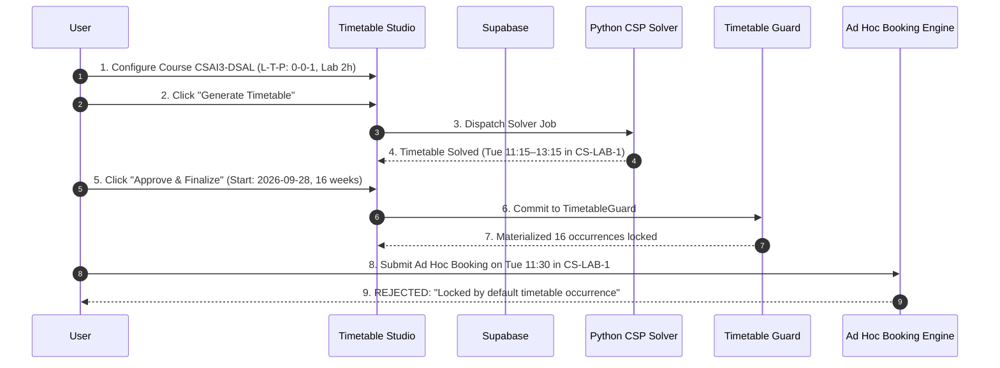

# Timetable Maker — Comprehensive Testing Strategy

## 1. Overview & Quality Objectives

The Timetable Maker requires a rigorous, multi-tiered testing strategy spanning mathematical constraint validation, solver performance benchmarks, API integration, and user interaction mechanics.

### Quality Goals:
1. **100% Hard Constraint Feasibility**: Zero teacher double-booking, room clash, section overlap, or room type mismatch in any generated timetable.
2. **Contact Hours Accuracy**: Every course receives exactly the weekly contact hours specified by its L-T-P values and configured durations.
3. **Continuous Lab Integrity**: Practical lab sessions never split across lunch breaks or operational day bounds.
4. **Zero Regression**: Unmodified operation of existing resource allocation, waitlists, and priority-aging pipelines.

---

## 2. Multi-Tiered Testing Pyramid

```
                ┌──────────────────────────────────┐
                │   End-to-End User Journey Tests   │
                │ (Catalog -> Solve -> Guard Block)│
                ├──────────────────────────────────┤
                │       API Contract Tests         │
                │  (Next.js Route Handlers, FastAPI)│
                ├──────────────────────────────────┤
                │     Python Solver Test Suite     │
                │(CSP, MRV, Forward Checking, Diag)│
                ├──────────────────────────────────┤
                │  Frontend Unit & Component Tests │
                │ (L-T-P Math, Vitest, Grid Drop)  │
                └──────────────────────────────────┘
```

---

## 3. Tier 1: Frontend Unit & Component Tests (Vitest)

Executed via: `npm run test`

### 3.1 L-T-P & Contact Hours Math Tests (`lib/__tests__/ltp.test.ts`)
- **TC-FE-01: Standard 3-1-2 Calculation**:
  - Input: $L=3, d_L=1.0, T=1, d_T=1.0, P=2, d_P=2.0$
  - Expected Weekly Contact Hours: $3(1.0) + 1(1.0) + 2(2.0) = \mathbf{8.0}\text{ hours}$.
  - Verify session count equals $3 + 1 + 2 = 6$ sessions.
- **TC-FE-02: Zero Practical / Pure Theory (4-0-0)**:
  - Input: $L=4, d_L=1.0, T=0, P=0$
  - Expected Weekly Contact Hours: $4.0\text{ hours}$.
- **TC-FE-03: Heavy 3-Hour Lab Session (0-0-1 with $d_P=3.0$)**:
  - Input: $L=0, T=0, P=1, d_P=3.0$
  - Expected Contact Hours: $3.0\text{ hours}$.
- **TC-FE-04: Credits Disconnect**:
  - Verify course with 2 Credits can be configured with 4 weekly lab hours without validation error.

### 3.2 Client-Side Drag-and-Drop Validator Tests (`lib/__tests__/drag_validator.test.ts`)
- **TC-FE-05: Lunch Boundary Collision**:
  - A 2-hour lab dropped at 12:00 (when lunch starts at 13:00) is rejected as invalid before drop.
- **TC-FE-06: Same Batch Collision**:
  - Moving a session into a slot where the same batch already has a lecture flags an immediate warning.

---

## 4. Tier 2: Python Solver Unit & Integration Tests (Pytest)

Executed via: `pytest tests/test_timetable_solver.py`

### 4.1 Expander & Domain Filtering Tests
- **TC-PY-01: Variable Expansion**:
  - Ensure a catalog of 5 courses with various L-T-P structures expands into the exact mathematical count of session variables.
- **TC-PY-02: Room Type Pruning**:
  - Verify that a practical session variable for `CSAI5-DLL` has domains restricted strictly to rooms where `room_type == 'lab'` and `lab_specialization == 'AI/ML GPU'`.
- **TC-PY-03: Teacher Availability Pruning**:
  - Ensure slots falling on a teacher's unavailable day/time are pruned prior to search.

### 4.2 Hard Constraint Enforcement Tests
- **TC-PY-04: Zero Teacher Clash**:
  - Generate a timetable for 4 sections sharing 2 common faculty members. Verify:
    $$\forall s_1, s_2 \in \text{Sessions}, s_1.\text{faculty} = s_2.\text{faculty} \implies \text{Interval}(s_1) \cap \text{Interval}(s_2) = \emptyset$$
- **TC-PY-05: Zero Room Clash**:
  - Verify no exclusive room is double-booked.
- **TC-PY-06: Zero Batch Clash**:
  - Verify no section is scheduled for two concurrent subjects.
- **TC-PY-07: Continuous Lab Block**:
  - Verify all lab sessions occupy contiguous periods without intermediate breaks.

### 4.3 Soft Constraint Optimization Tests
- **TC-PY-08: Daily Load Variance**:
  - Measure variance of daily hours per batch: ensure standard deviation $\le 1.5$ hours across days.
- **TC-PY-09: Gap Minimization**:
  - Verify that single-hour empty slots between student classes are minimized.

### 4.4 Diagnostic & Bottleneck Tests
- **TC-PY-10: Intentionally Unsatisfiable Schedule (Overloaded Teacher)**:
  - Assign 40 hours of courses to a teacher with 20 available hours.
  - Verify solver returns `False` and diagnostic report identifies teacher overload with exact deficit.
- **TC-PY-11: Room Crunch Diagnostic**:
  - 50 hours of GPU labs demanded on a single GPU lab room with 35 operational slots.
  - Verify diagnostic reports laboratory capacity crunch on room `CS-LAB-2`.

---

## 5. Tier 3: API & Contract Tests

- **TC-API-01: `POST /timetable/generate` Payload Validation**:
  - Rejects malformed requests (e.g., negative duration, missing courses) with HTTP 422.
- **TC-API-02: `POST /timetable/validate-move` Speed**:
  - Single-move collision check executes in $\le 10\text{ ms}$.
- **TC-API-03: `POST /api/timetable-maker/commit`**:
  - Verified role requirement: Only users with role `"hod"` or `"admin"` can commit to `TimetableGuard`.

---

## 6. Tier 4: End-to-End Integration & Regression Tests

### 6.1 The Complete Golden Journey

- **TC-E2E-01: Ad Hoc Guard Enforcement**:
  - Execute the sequence above and assert that an ad hoc request submitted via `POST /requests` on a finalized timetable slot is immediately turned away by `TimetableGuard`.
- **TC-E2E-02: Existing Analyzer Parity**:
  - Feed the generated schedule into `src/algorithm_engine/timetable_analyzer.py` and verify `report.clean == True` with 0 hard conflicts.

---

## 7. Critical Edge Cases & Stress Scenarios

| Test Case | Scenario | Expected Behavior |
|---|---|---|
| **EC-01** | Course with only Theory ($L>0, T=0, P=0$) | Schedulable into standard 1-hour classroom periods. |
| **EC-02** | Course with only Practical ($L=0, T=0, P=1, d_P=3.0\text{h}$) | Schedulable only into 3-hour continuous blocks (e.g., 08:00–11:00 or 14:00–17:00). |
| **EC-03** | Section strength (65) exceeds Lab capacity (30) | System forces sub-batch split into `Batch A1` (33) and `Batch A2` (32) and schedules both. |
| **EC-04** | Faculty member on leave on Friday | No sessions for this faculty member placed on Friday. |
| **EC-05** | Real-world benchmark: 10 sections, 60 courses, 28 rooms (`data/tt_opt/`) | Solver completes full generation in $\le 5.0$ seconds. |
| **EC-06** | Manual lock preservation | User locks 3 sessions, modifies catalog, triggers re-generation; all 3 locked sessions maintain exact original slots. |
